<div align="center">


<a href="https://github.com/feconutdev">
  
</a>

<br/><br/>



<sub>~ bò nhỏ đang gõ phím cùng mình ~</sub>

</div>

<br/>

## ☕ Về mình

```text
 (\_/)
 (•ᴗ•)   Chào bạn, mình là feconutdev.
 / >🍵   Một người mới, đang tập code, thích mọi thứ nhẹ nhàng
         và yên tĩnh như một buổi chiều đọc truyện tranh.
```

- 🌾 Tài khoản mới, mọi thứ vừa bắt đầu
- 📖 Thích phong cách giản dị, màu be ấm và những thứ mang hơi hướng anime
- 🧶 Tin rằng học chậm mà đều còn hơn học nhanh rồi bỏ
- 🎯 Mục tiêu lớn nhất: trở thành một người nổi tiếng, để nhiều người biết đến những gì mình làm

<br/>

## 🌱 Mình đang học

<div align="center">

| Môn | Tiến độ | Ghi chú |
|:---|:---|:---|
| **HTML** | ▰▰▰▰▰▱▱▱▱▱ | dựng khung trang, làm quen thẻ |
| **CSS** | ▰▰▰▰▱▱▱▱▱▱ | căn chỉnh, màu sắc, bố cục |
| **JavaScript** | ▰▰▰▱▱▱▱▱▱▱ | biến, hàm, DOM, sự kiện |
| **Python** | ▰▰▰▱▱▱▱▱▱▱ | cú pháp, vòng lặp, viết script nhỏ |
| **Node.js** | ▰▰▱▱▱▱▱▱▱▱ | chạy JS ngoài trình duyệt |
| **npm** | ▰▰▱▱▱▱▱▱▱▱ | cài và quản lý thư viện |

</div>

<br/>

## 🧰 Công cụ

<div align="center">


</div>

<br/>

## 📊 Thống kê

<div align="center">


<br/>


</div>

<br/>

## 🐍 Rắn ăn contribution

<div align="center">


<sub>con rắn sẽ ăn hết những ô xanh mỗi khi mình commit</sub>

</div>

## 💌 Một vài điều nhỏ

- 🍵 Đang uống: trà nóng
- 🎧 Đang nghe: nhạc lofi nhẹ nhàng
- 📺 Đang xem: anime thể loại đời thường
- 🐮 Linh vật: một chú bò pixel
- 💬 Hỏi mình về: HTML, CSS, JavaScript, Python, Node.js, npm (mình cũng đang học nên cùng trao đổi nhé)

<br/>

<div align="center">

> *"Nổi tiếng không phải đích đến trong một đêm,*
> *mà là kết quả của việc không bỏ cuộc mỗi ngày."*

<br/>


</div>
